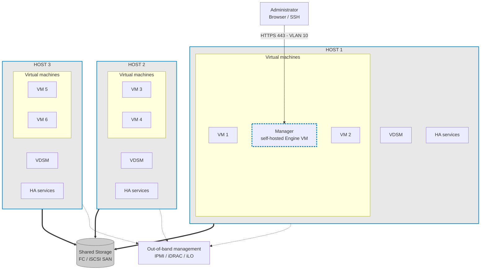
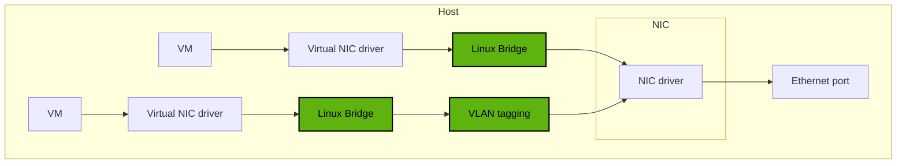
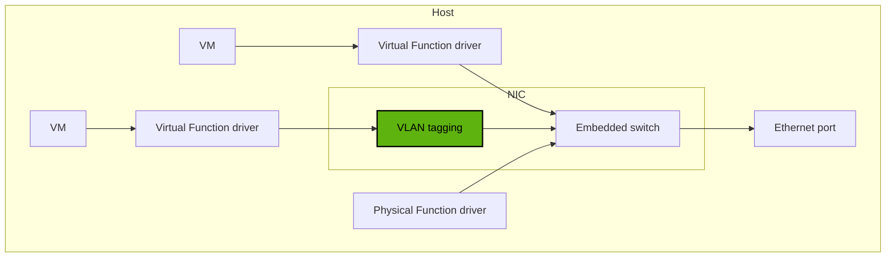
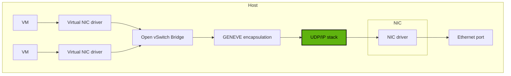

# oVirt Self-Hosted Engine: 3-Node Cluster 

A deployment guide for an oVirt virtualization cluster with three hypervisor nodes, a shared SAN (Fibre Channel or iSCSI), and a highly available self-hosted Engine VM.

> **Status:** Template / lab documentation. All IPs, FQDNs, VLAN IDs and subnets are **examples**. Replace them with your real values (see [Lab Details](#13-lab-details)).

---

## Table of Contents

1. [Project Overview](#1-project-overview)
2. [Architecture Diagram](#2-architecture-diagram)
3. [Network and VLAN Design](#3-network-and-vlan-design)
4. [Resource Requirements](#4-resource-requirements)
5. [Prerequisites](#5-prerequisites)
6. [Firewall Port Allowlist](#6-firewall-port-allowlist)
7. [Installation Recommendations](#7-installation-recommendations)
8. [Step-by-Step Deployment](#8-step-by-step-deployment)
9. [Post-Deployment Hardening and Backup](#9-post-deployment-hardening-and-backup)
10. [Troubleshooting](#10-troubleshooting)
11. [Cleanup a Failed Deployment](#11-cleanup-a-failed-deployment)
12. [Official References](#12-official-references)
13. [Lab Details](#13-lab-details)

---

## 1. Project Overview

This project documents deployment of:

- Three oVirt hypervisor nodes
- One shared SAN storage system
- One highly available self-hosted oVirt Engine VM
- VLAN-based network separation
- Centralized management through the oVirt Administration Portal
- Offline installation using a local package repository, where supported

The Engine VM runs on an eligible cluster node and can be restarted on another eligible node if its host fails, **provided shared storage, fencing, networking and spare capacity are configured correctly**.

### Goals

| Goal | How it is met |
|---|---|
| No single point of failure for management | Engine VM is HA across 3 nodes |
| Shared storage for live migration | All nodes access the same SAN LUNs |
| Traffic isolation | Separate VLANs for management, VM, storage, migration |
| Safe failover | Out-of-band fencing (IPMI / iDRAC / iLO) |
| Isolated-site support | Local mirrored repository and Engine appliance |

---

## 2. Architecture Diagram



Each host runs **VDSM** (the agent the Engine uses to manage the host) and the **HA services** (`ovirt-ha-agent` / `ovirt-ha-broker`) that monitor and restart the Engine VM. The **Manager** is the self-hosted Engine VM: it runs on one host at a time and lives on shared storage, so HA services can restart it on Host 2 or Host 3 if Host 1 fails. All three hosts connect to the same shared SAN storage. Fencing lets the cluster safely power off or isolate a failed host before restarting its workloads.

### Architecture components

| Component | Description |
|---|---|
| Node 1 | Initial deployment host and hypervisor |
| Node 2 | Additional hypervisor and Engine HA candidate |
| Node 3 | Additional hypervisor and Engine HA candidate |
| Engine VM | Manages hosts, clusters, storage, networks and virtual machines |
| Shared SAN | Provides shared storage accessible by all three nodes |
| DNS | Forward and reverse name resolution |
| NTP | Keeps host and Engine clocks synchronized |
| Fencing | Safely isolates or powers off a failed or isolated host |
| Physical switches | Carry management, VM, migration and storage traffic |

### Traffic flows

| Flow | Path |
|---|---|
| Admin access | Browser → VLAN 10 → Engine FQDN (HTTPS 443) |
| Engine ↔ hosts | Engine VM → VDSM on each host (TCP 54321) |
| Live migration | Host → host over the migration network |
| Storage I/O | Each host → SAN (FC fabric or iSCSI VLAN 30) |
| Fencing | Host/Engine → BMC interface (IPMI/iDRAC/iLO) |

---

## 3. Network and VLAN Design

Example plan. **Replace with your actual lab values.**

| VLAN | Name | Purpose | Example subnet |
|---|---|---|---|
| 10 | MGMT | Host management and Engine access | 10.10.10.0/24 |
| 20 | VM-PROD | Virtual machine traffic | 10.10.20.0/24 |
| 30 | STORAGE | iSCSI traffic, if applicable | 10.10.30.0/24 |
| 40 | MIGRATION | Live migration traffic | 10.10.40.0/24 |

Recommendations:

- Use static or reserved IP addresses for all nodes and the Engine.
- Configure VLAN trunks and allowed VLANs on physical switches.
- Create the corresponding logical networks in oVirt.
- Use redundant NICs and switch paths where possible (bonding / multipath).
- Start with MTU 1500. Enable jumbo frames only after verifying every device on the path.
- Keep storage traffic isolated from user VM traffic where practical.
- Use a separate, protected management network for IPMI / iDRAC / iLO fencing.

> **Storage distinction:** Fibre Channel uses SAN fabrics, zoning and LUN masking. It does **not** use an Ethernet VLAN. VLAN 30 applies only to Ethernet-based storage such as iSCSI.

### VM network connectivity options (host network diagrams)

oVirt can connect VMs to the physical network in three ways. Green boxes are configured by the oVirt host network configuration.

#### Linux Bridge (default)

VMs attach through a virtual NIC to a Linux bridge that oVirt creates on the host. VLAN tagging is applied on the host and traffic leaves through the NIC driver to the Ethernet port.



#### SR-IOV

VMs use a **Virtual Function (VF)** driver that talks directly to the NIC's embedded switch, bypassing the host bridge. The host keeps the **Physical Function (PF)** driver. VLAN tagging is configured on the NIC.



#### OVN (Open Virtual Network)

VMs attach to an **Open vSwitch bridge**. Traffic between hosts is encapsulated with **GENEVE** and sent over the host UDP/IP stack, then out through the NIC driver and Ethernet port.



#### Choosing a connectivity option

| Option | Best for | Notes |
|---|---|---|
| Linux Bridge | General VM networking, VLANs, bonding | Default and simplest; recommended starting point |
| SR-IOV | High-throughput or low-latency VMs | Needs an SR-IOV capable NIC with IOMMU/VT-d enabled; VMs bypass the host bridge, so check feature and live-migration limits for your release |
| OVN | Software-defined overlay networks between hosts | Requires the OVN provider; see the OVN firewall ports (TCP 6642, UDP 6081) in the [firewall allowlist](#6-firewall-port-allowlist); GENEVE adds encapsulation overhead, so plan MTU accordingly |

---

## 4. Resource Requirements

### 4.1 oVirt Engine VM

| Resource | Minimum | Recommended |
|---|---|---|
| CPU | Dual-core x86_64 | Quad-core x86_64 |
| RAM | 4 GB available, subject to documented conditions | 16 GB |
| Local writable disk | 25 GB | 50 GB |
| Network | 1 Gbps NIC | 1 Gbps NIC or better |

The self-hosted Engine storage domain has a **separate** storage requirement. Confirm the current guide's required capacity before allocating the SAN LUN.

### 4.2 Hypervisor nodes

| Resource | Requirement / recommendation |
|---|---|
| CPU | Supported x86_64 CPU with Intel VT-x or AMD-V enabled |
| NX | CPU No eXecute support required |
| RAM | Official minimum 2 GB; production sizing must be based on workload |
| Boot disk | oVirt Node minimum total documented as 64 GiB; use default allocations |
| Network | At least 1 Gbps; faster links recommended for VM and migration traffic |
| Storage | Shared SAN access from every node |
| Firmware | Compatible NIC, HBA, BIOS/UEFI and storage firmware |

> **Production sizing (N+1):** Do not size hosts using minimums alone. Calculate the CPU and memory needed for all critical VMs to keep running on the remaining two nodes if one node fails. Reserve resources for the Engine VM as well.

Quick sizing check:

```
Usable capacity per node  = Total RAM/CPU of node − hypervisor overhead − Engine VM reserve
Cluster must satisfy      : Total VM demand ≤ (Usable capacity per node × 2)
```

---

## 5. Prerequisites

### 5.1 Hardware

- [ ] Three compatible hypervisor hosts
- [ ] CPU virtualization enabled in BIOS/UEFI
- [ ] Three host boot disks (RAID1 recommended)
- [ ] Shared SAN with sufficient usable capacity
- [ ] Compatible FC HBAs, or Ethernet NICs for iSCSI
- [ ] Redundant switches, NICs and storage paths where possible
- [ ] Out-of-band fencing management configured and reachable
- [ ] UPS and redundant power for production equipment

### 5.2 Network and DNS

- [ ] Management, VM, migration and storage network design finalized
- [ ] VLANs configured on physical switches
- [ ] Static or reserved IPs allocated
- [ ] DNS A records created for all nodes and the Engine
- [ ] Reverse DNS (PTR) records created and verified
- [ ] External DNS and NTP services available
- [ ] Routing and firewall rules verified
- [ ] No duplicate IP addresses

Use a fully qualified domain name (FQDN) for each host and the Engine. Forward and reverse DNS must be consistent. DNS should be **external** to the oVirt environment (do not host it on a VM inside the cluster).

Example names:

| Role | FQDN |
|---|---|
| Node 1 | `ovirt-node01.lab.example.com` |
| Node 2 | `ovirt-node02.lab.example.com` |
| Node 3 | `ovirt-node03.lab.example.com` |
| Engine | `ovirt-engine.lab.example.com` |

Verify (replace the example domain):

```bash
hostname -f
getent hosts ovirt-node01.lab.example.com
getent hosts ovirt-node02.lab.example.com
getent hosts ovirt-node03.lab.example.com
getent hosts ovirt-engine.lab.example.com
# Reverse lookup check
getent hosts <IP-ADDRESS>
```

Check time sync on every host:

```bash
chronyc tracking
timedatectl
```

### 5.3 SAN

- [ ] SAN LUNs or targets presented to all three nodes
- [ ] FC zoning and LUN masking configured, or iSCSI ACLs configured
- [ ] Multipath configured where supported
- [ ] Same LUN identity (WWID) visible on every node
- [ ] Storage firmware and interoperability checked
- [ ] Engine storage capacity reserved
- [ ] Workload storage separated from the Engine storage domain where practical

> **Warning:** Do not format or initialize an existing shared LUN without confirming its purpose and contents.

### 5.4 Software and repository

- [ ] Exact oVirt release selected
- [ ] Supported host OS/image selected
- [ ] Required packages and dependencies available
- [ ] Engine appliance available
- [ ] Offline repository metadata and packages staged if the environment is isolated
- [ ] Checksums and package signatures verified where available

Review current supported platforms before choosing Node NG:

- https://ovirt.org/download/
- https://ovirt.org/download/node.html

> Do not assume that an Oracle Linux offline procedure applies unchanged to oVirt on CentOS Stream.

---

## 6. Firewall Port Allowlist

This is a **planning matrix**. Restrict rules to the documented source and destination systems rather than opening ports to every network.

### 6.1 Engine ports

| Port | Protocol | Source | Destination | Purpose |
|---|---|---|---|---|
| 22 | TCP | Authorized administrators | Engine VM | Optional SSH administration |
| 2222 | TCP | Clients requiring serial consoles | Engine VM | VM serial console access |
| 80, 443 | TCP | Admin clients, API clients, hosts | Engine VM | Portal, REST API and HTTPS |
| 6100 | TCP | Portal clients | Engine VM | WebSocket proxy for noVNC, when used |
| 7410 | UDP | Hosts | Engine VM | `fence_kdump`, when enabled |
| 54323 | TCP | Administration Portal clients | Engine VM | `ovirt-imageio` service |
| 6642 | TCP | Hosts | OVN southbound database | Required when using the relevant OVN provider setup |
| 53 | TCP/UDP | Engine VM | DNS server | Name resolution |
| 123 | UDP | Engine VM | NTP server | Time synchronization |

Ports 9696 and 35357 are relevant only to certain external OVN network-provider configurations. Enable them only if that integration is deployed.

### 6.2 Hypervisor host ports

| Port | Protocol | Source | Destination | Purpose |
|---|---|---|---|---|
| 22 | TCP | Engine VM | Hosts | Optional SSH host access |
| 2223 | TCP | Engine VM | Hosts | VM serial console access |
| 5900–6923 | TCP | Authorized console clients | Hosts | VNC/SPICE console access, as configured |
| 9090 | TCP | Authorized administrators / Engine clients | Hosts | Cockpit, if installed and used |
| 16514 | TCP | Hosts | Hosts | Libvirt migration |
| 49152–49215 | TCP | Hosts | Hosts | VDSM migration/fencing traffic |
| 54321 | TCP | Engine VM and hosts | Hosts | VDSM management communications |
| 54322 | TCP | Engine image I/O service | Hosts | Image I/O communications |
| 53 | TCP/UDP | Hosts | DNS server | Name resolution |
| 123 | UDP | Hosts | NTP server | Time synchronization |
| 6081 | UDP | Hosts | Hosts | OVN tunnels, when OVN is used |

Additional optional ports:

| Port | Protocol | Use |
|---|---|---|
| 161 | UDP | SNMP traps, if configured |
| 111 | TCP | NFS-related service requirement listed by oVirt; verify the storage protocol and NFS version in use |
| 5989 | TCP/UDP | CIM monitoring, if configured |
| 4500 | TCP/UDP | IPsec, if used |
| 500 | UDP | IPsec, if used |
| AH / ESP | IP protocols | IPsec, if used |

> For console access, do not expose the entire VNC/SPICE range to untrusted networks. Restrict it to approved clients and the required console workflow.

### 6.3 Storage and fencing firewall rules

**iSCSI**
- TCP 3260 is the common iSCSI target port.
- Allow initiator-to-target traffic only between the three nodes and the configured SAN target IPs.
- Follow the SAN vendor's requirements for discovery, management and multipath.

**Fibre Channel**
- FC is a fabric connection and does not use TCP/UDP storage ports.
- Configure zoning, LUN masking and redundant fabric paths.

**NFS (if used)**
- Allow the storage-server traffic required by the selected NFS version and export configuration.
- NFSv4 commonly uses TCP 2049; NFSv3 may need additional RPC services and ports.

**Fencing**
- Allow each node to reach the management interfaces of the other hosts.
- Required ports depend on the fencing agent and hardware. For IPMI, UDP 623 is commonly used; verify your agent and vendor configuration.

### 6.4 Firewall preparation commands

Run on the initial deployment host:

```bash
systemctl unmask firewalld
systemctl enable --now firewalld
systemctl status firewalld
firewall-cmd --get-active-zones
firewall-cmd --get-default-zone
```

The management interface must belong to an active zone.

Prefer the oVirt installer and host-management workflow to configure required rules where supported. Review the resulting rules against your security policy. **Do not disable `firewalld`.**

Review the rules after deployment:

```bash
firewall-cmd --list-all
firewall-cmd --list-services
firewall-cmd --list-ports
```

> This is a planning allowlist, not a universal one-command firewall script. The final policy depends on the oVirt release, optional features, host type, storage protocol and fencing hardware.

Official reference: https://ovirt.org/documentation/planning_and_prerequisites_guide/

---

## 7. Installation Recommendations

1. **Select a supported release and host image first.** Check the current oVirt release notes and platform matrix.
2. Use the same supported OS/image, compatible firmware and CPU family on all three nodes where possible.
3. Configure DNS and NTP before starting deployment.
4. Configure shared SAN connectivity and verify LUN visibility on every host.
5. Keep the Engine storage domain dedicated to the Engine VM.
6. Use separate logical networks for management, VM traffic, migration and IP storage where practical.
7. Configure fencing before relying on HA.
8. Keep `firewalld`, SELinux and HTTPS enabled.
9. Use individual administrator accounts and limit root access.
10. Back up the Engine and store the backup outside the cluster.
11. Document VLANs, switch ports, SAN WWIDs, DNS records, host IPs and fencing details.
12. For offline installations, mirror all required packages and dependencies for the exact release.
13. Do not mix commands from Oracle Linux Virtualization Manager documentation with oVirt without verifying compatibility.
14. Test VM migration, Engine failover and recovery before using the cluster for important workloads.

---

## 8. Step-by-Step Deployment

### Step 1: Prepare the hosts

Install the selected supported host image on Node 1, Node 2 and Node 3.

Configure unique hostnames and management IP addresses. Confirm that all hosts can resolve one another and the planned Engine FQDN.

### Step 2: Configure VLANs and switch ports

Configure physical switch ports and VLANs according to the network plan.

Verify management connectivity first, then configure VM, migration and storage networks according to the intended topology.

### Step 3: Configure the SAN

Present the required shared LUN or target to all nodes.

- **FC:** configure zoning and LUN masking.
- **iSCSI:** configure target access and the storage network.

Confirm consistent storage visibility on all nodes before deployment.

### Step 4: Enable the firewall

On the initial deployment host:

```bash
systemctl unmask firewalld
systemctl enable --now firewalld
firewall-cmd --get-active-zones
```

Verify that the management interface is in the intended active zone. Review the [firewall matrix](#6-firewall-port-allowlist) and the release-specific oVirt documentation.

### Step 5: Prepare the offline repository (if required)

On a connected staging system, collect the packages, dependencies, metadata and Engine appliance required for the exact release.

Transfer the repository to a location reachable by the hosts and Engine VM during deployment. Test package resolution before starting the isolated installation:

```bash
dnf clean all
dnf repolist
dnf info ovirt-hosted-engine-setup
```

> A repository created for one CentOS Stream or oVirt release may not work with another.

### Step 6: Install deployment tooling

On Node 1, use the package repositories appropriate for the selected host OS and release.

For a compatible Enterprise Linux host with configured oVirt repositories:

```bash
dnf install -y ovirt-hosted-engine-setup
dnf install -y tmux
```

Confirm package availability before running these on an oVirt Node NG image.

### Step 7: Start a persistent terminal session

```bash
tmux new-session -s ovirt-deploy
```

This lets you reconnect if your SSH session drops (`tmux attach -t ovirt-deploy`).

### Step 8: Deploy the self-hosted Engine

Run the interactive deployment on Node 1:

```bash
hosted-engine --deploy
```

Follow the prompts for:

- Management bridge and network configuration
- Engine FQDN and IP address
- DNS and gateway details
- Storage type and SAN connection
- Engine VM CPU, RAM and disk allocation
- Administrator credentials

Use the shared SAN storage intended for the hosted-engine storage domain.

### Step 9: Generate an answer file (if supported)

If the installed version supports the option:

```bash
mkdir -p /root/ovirt-deploy

hosted-engine --deploy \
  --generate-answer=/root/ovirt-deploy/answers.conf
```

Verify the file:

```bash
ls -l /root/ovirt-deploy/answers.conf
```

Confirm supported options with `hosted-engine --help`. **Answer files can contain secrets. Protect them and never commit them to GitHub.**

### Step 10: Optional offline extra variables

Use these only if the documentation for your release supports them. Example file `/root/extra-vars.yml` (disables Keycloak):

```yaml
---
he_offline_deployment: true
he_enable_keycloak: false
```

The YAML file must begin with `---`. `he_enable_keycloak: true` means Keycloak is enabled.

If supported by your installed release, the deployment pattern may be:

```bash
hosted-engine --deploy --4   --config-append=/root/ovirt-deploy/answers.conf  --ansible-extra-vars="@/root/extra-vars.yml"
```

Verify accepted options with `hosted-engine --help`. Do not assume Oracle-specific variables work with every oVirt release.

### Step 11: Verify the Engine VM

```bash
hosted-engine --vm-status
```

Review deployment logs:

```bash
ls -ltr /var/log/ovirt-hosted-engine-setup/
```

Open the Administration Portal at `https://<engine-fqdn>/ovirt-engine/` and verify the Engine is healthy.

### Step 12: Add Node 2 and Node 3

In the Administration Portal:

1. Add Node 2 as a host.
2. Select the self-hosted Engine deployment option (so the host is an Engine HA candidate).
3. Repeat for Node 3.
4. Confirm all three hosts are in the intended cluster.
5. Confirm the hosted-engine storage domain is active.
6. Configure and test fencing.
7. Configure the logical networks and VLAN tags.
8. Add separate storage domains for normal VM workloads.

### Step 13: Validate the cluster

Run on each host:

```bash
hostname -f
getent hosts ovirt-engine.lab.example.com
systemctl is-active firewalld
firewall-cmd --get-active-zones
lsblk
multipath -ll
```

`multipath -ll` applies only when multipath is configured.

In the Administration Portal, confirm:

- [ ] Three hosts are **Up**
- [ ] The Engine VM and HA status are healthy
- [ ] Shared SAN storage is visible and active
- [ ] All required logical networks are attached correctly
- [ ] A test VM can start and migrate between hosts
- [ ] Fencing works in a planned maintenance test
- [ ] An Engine backup exists outside the cluster

---

## 9. Post-Deployment Hardening and Backup

- Keep SELinux in enforcing mode and `firewalld` running.
- Replace the default Engine certificate with one from your internal CA if required by policy.
- Create named administrator accounts; avoid sharing `admin@internal`.
- Restrict SSH to the management VLAN and authorized administrators.
- Apply updates one host at a time using maintenance mode so VMs migrate away first.

Engine backup (run on the Engine VM; copy the files off-cluster):

```bash
engine-backup --mode=backup \
  --file=/root/engine-backup-$(date +%F).tar.bz2 \
  --log=/root/engine-backup-$(date +%F).log
```

Check Engine HA agents on each host:

```bash
systemctl status ovirt-ha-agent ovirt-ha-broker
```

---

## 10. Troubleshooting

| Symptom | Things to check |
|---|---|
| Deployment fails on DNS/FQDN | Forward and reverse records, `/etc/hosts`, `hostname -f` |
| Engine cannot reach host | VDSM on TCP 54321, firewall zone, time sync |
| SAN LUN not visible on a node | Zoning/masking or iSCSI ACLs, `lsblk`, `multipath -ll`, `iscsiadm -m session` |
| Host stays *Non-Operational* | Missing logical network, storage domain not reachable |
| Live migration fails | Migration network, ports 16514 and 49152–49215, CPU compatibility |
| Engine VM does not restart on another host | Fencing, free resources, HA agent/broker status, storage lock |

Useful log locations:

```bash
/var/log/ovirt-hosted-engine-setup/     # deployment logs
/var/log/ovirt-hosted-engine-ha/        # HA agent and broker
/var/log/vdsm/vdsm.log                  # host agent
/var/log/ovirt-engine/engine.log        # on the Engine VM
```

---

## 11. Cleanup a Failed Deployment

This command can change or remove hosted-engine configuration. Use it only to intentionally clean up a failed deployment, after reviewing storage and host state:

```bash
/usr/sbin/ovirt-hosted-engine-cleanup
```

> Do **not** run this on a working cluster or use it as a general-purpose SAN reset.

---

## 12. Official References

- oVirt downloads: https://ovirt.org/download/
- oVirt Node downloads: https://ovirt.org/download/node.html
- Planning and prerequisites: https://ovirt.org/documentation/planning_and_prerequisites_guide/
- Self-hosted Engine installation: https://ovirt.org/documentation/installing_ovirt_as_a_self-hosted_engine_using_the_command_line/
- Oracle Linux Virtualization Manager offline guide (reference only): https://docs.oracle.com/en/virtualization/oracle-linux-virtualization-manager/getstart/gestarted-he-deploy-noaccess.html

The Oracle guide is a reference only. Validate all commands, variables and repositories against your exact oVirt release.

---

## 13. Lab Details

| Item | Value |
|---|---|
| oVirt release | TBD |
| Host OS / image | TBD |
| Node 1 FQDN / IP | TBD |
| Node 2 FQDN / IP | TBD |
| Node 3 FQDN / IP | TBD |
| Engine FQDN / IP | TBD |
| Management VLAN / subnet | TBD |
| VM VLAN / subnet | TBD |
| Migration VLAN / subnet | TBD |
| Storage protocol (FC or iSCSI) | TBD |
| SAN target / LUN WWID | TBD |
| SAN capacity | TBD |
| DNS / NTP servers | TBD |
| Fencing method | TBD |

---
## 14. Answers file  sample
[root@ovirt-engine ~]# cat /root/ovirt-deploy/answers.conf
[environment:default]
OVEHOSTED_CORE/deployProceed=bool:True
OVEHOSTED_CORE/enableKeycloak=bool:none:None
OVEHOSTED_CORE/forceIpProceed=str:yes
OVEHOSTED_CORE/screenProceed=bool:True
OVEHOSTED_ENGINE/clusterName=str:Default
OVEHOSTED_ENGINE/datacenterName=str:Default
OVEHOSTED_ENGINE/enableHcGlusterService=none:None
OVEHOSTED_ENGINE/insecureSSL=none:None
OVEHOSTED_NETWORK/bridgeName=str:ovirtmgmt
OVEHOSTED_NETWORK/fqdn=str:ovirt1-engine.swan.local
OVEHOSTED_NETWORK/gateway=str:10.1.*.*     
OVEHOSTED_NETWORK/network_test=str:dns
OVEHOSTED_NETWORK/network_test_tcp_address=none:None
OVEHOSTED_NETWORK/network_test_tcp_port=none:None
OVEHOSTED_NOTIF/destEmail=str:root@localhost
OVEHOSTED_NOTIF/smtpPort=str:25
OVEHOSTED_NOTIF/smtpServer=str:localhost
OVEHOSTED_NOTIF/sourceEmail=str:root@localhost
OVEHOSTED_STORAGE/LunID=none:None
OVEHOSTED_STORAGE/discardSupport=bool:False
OVEHOSTED_STORAGE/domainType=none:None
OVEHOSTED_STORAGE/iSCSIDiscoverUser=none:None
OVEHOSTED_STORAGE/iSCSIPortal=none:None
OVEHOSTED_STORAGE/iSCSIPortalIPAddress=none:None
OVEHOSTED_STORAGE/iSCSIPortalPort=none:None
OVEHOSTED_STORAGE/iSCSIPortalUser=none:None
OVEHOSTED_STORAGE/iSCSITargetName=none:None
OVEHOSTED_STORAGE/imgSizeGB=none:None
OVEHOSTED_STORAGE/imgUUID=str:790049e2-f82f-482d-8cd5-8cfbe078abc3
OVEHOSTED_STORAGE/lockspaceImageUUID=none:None
OVEHOSTED_STORAGE/lockspaceVolumeUUID=none:None
OVEHOSTED_STORAGE/metadataImageUUID=none:None
OVEHOSTED_STORAGE/metadataVolumeUUID=none:None
OVEHOSTED_STORAGE/mntOptions=none:None
OVEHOSTED_STORAGE/nfsVersion=none:None
OVEHOSTED_STORAGE/storageDomainConnection=none:None
OVEHOSTED_STORAGE/storageDomainName=str:hosted_storage
OVEHOSTED_STORAGE/volUUID=str:ec9cb81b-19df-4acf-a5a4-17cf46f46d4d
OVEHOSTED_VM/OpenScapProfileName=none:None
OVEHOSTED_VM/applyOpenScapProfile=bool:False
OVEHOSTED_VM/automateVMShutdown=bool:True
OVEHOSTED_VM/cdromUUID=str:327f44be-7476-41a2-a243-efa396ff1e3f
OVEHOSTED_VM/cloudInitISO=str:generate
OVEHOSTED_VM/cloudinitExecuteEngineSetup=bool:True
OVEHOSTED_VM/cloudinitInstanceDomainName=str:swan.local
OVEHOSTED_VM/cloudinitInstanceHostName=str:ovirt1-engine.swan.local
OVEHOSTED_VM/cloudinitVMDNS=str:10.1.*.*   -- DNS IP 
OVEHOSTED_VM/cloudinitVMETCHOSTS=bool:True
OVEHOSTED_VM/cloudinitVMStaticCIDR=str:10.1.5.*/24   - Host IP 
OVEHOSTED_VM/cloudinitVMTZ=str:Etc/UTC
OVEHOSTED_VM/consoleUUID=str:f799bc43-0295-49f8-9e41-7662f78ece61
OVEHOSTED_VM/emulatedMachine=str:pc
OVEHOSTED_VM/enableFips=bool:False
OVEHOSTED_VM/nicUUID=str:e54b1964-3e61-4acd-95a7-32a743d3ee04
OVEHOSTED_VM/ovfArchive=str:
OVEHOSTED_VM/rootSshAccess=str:yes
OVEHOSTED_VM/rootSshPubkey=str:
OVEHOSTED_VM/vmCDRom=none:None
OVEHOSTED_VM/vmMACAddr=str:00:16:3e:1e:f4:1c
OVEHOSTED_VM/vmMemSizeMB=int:4096
OVEHOSTED_VM/vmVCpus=str:3
[root@ovirt-engine ~]# 


